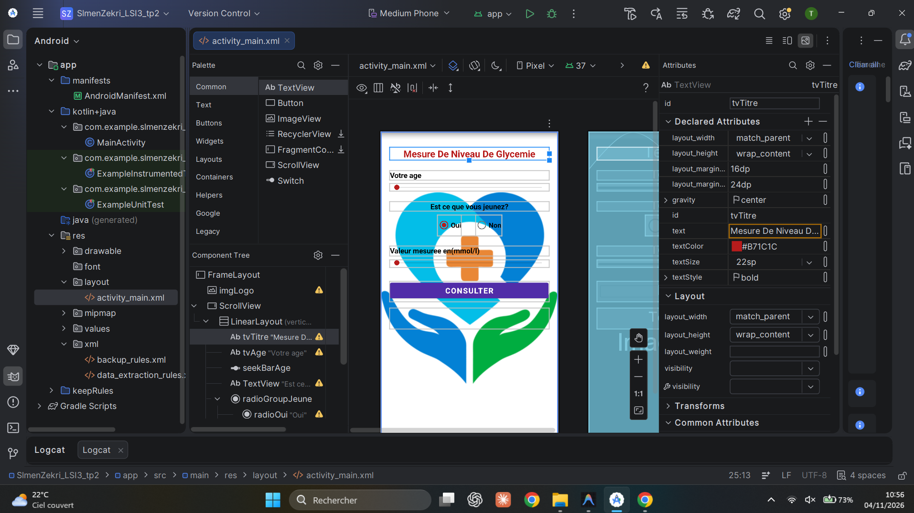
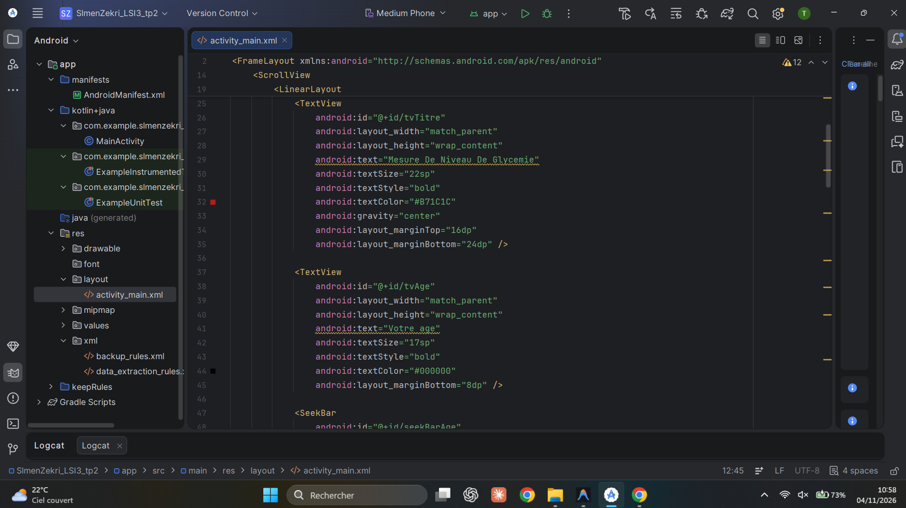
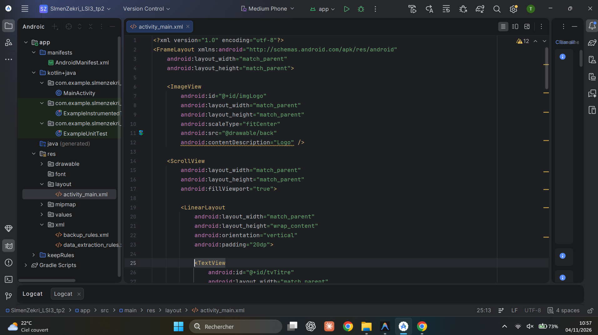
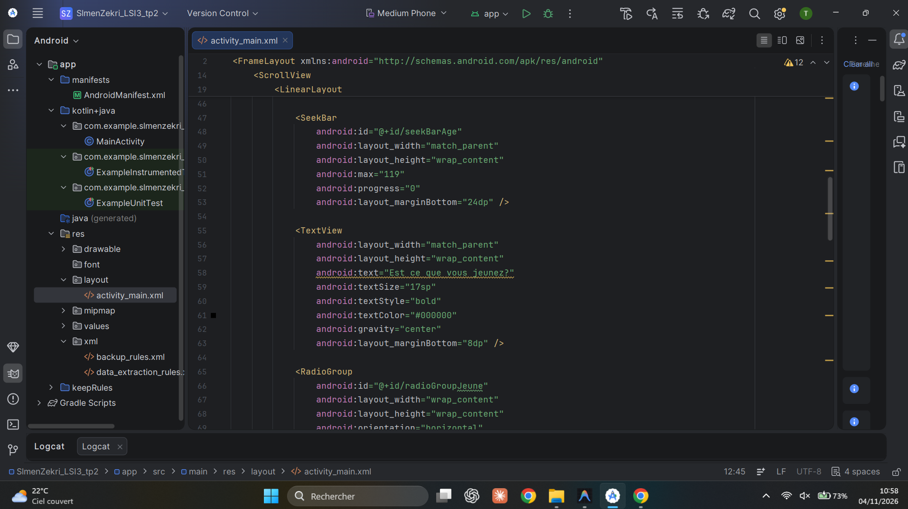
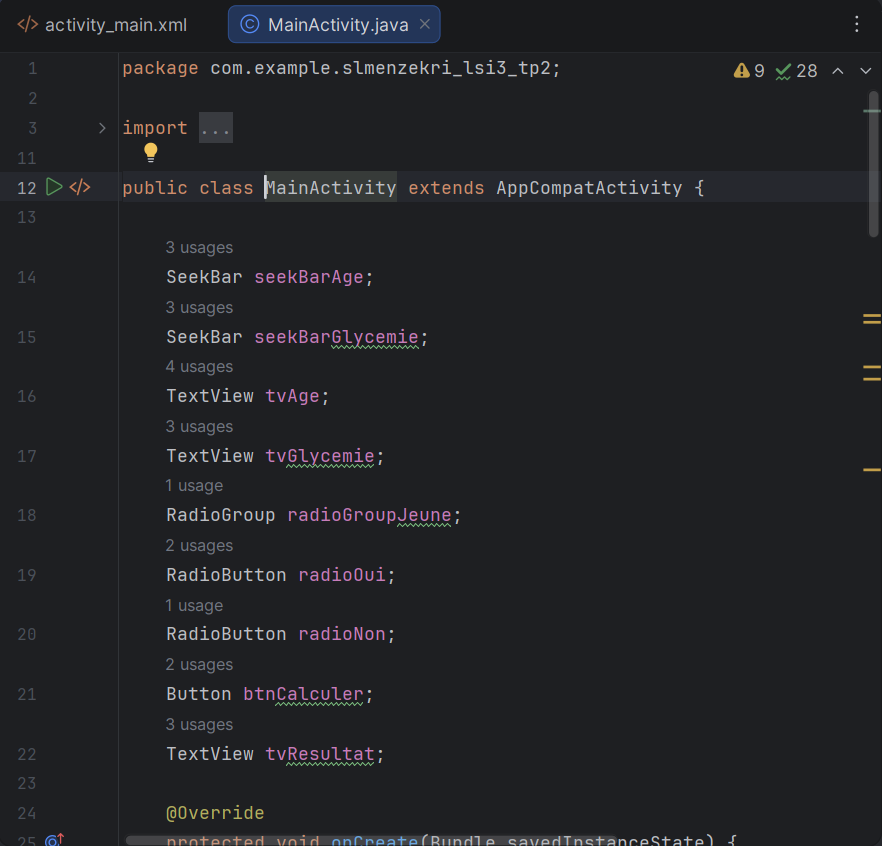
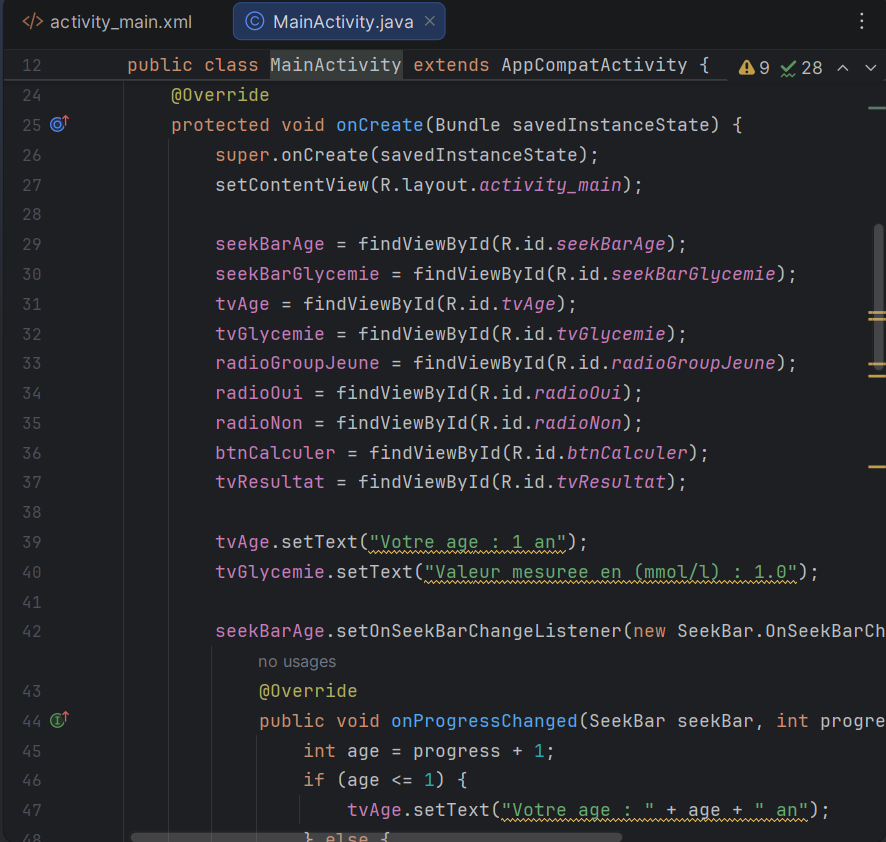
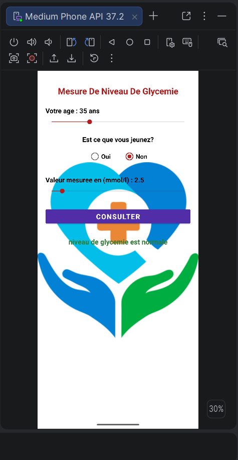
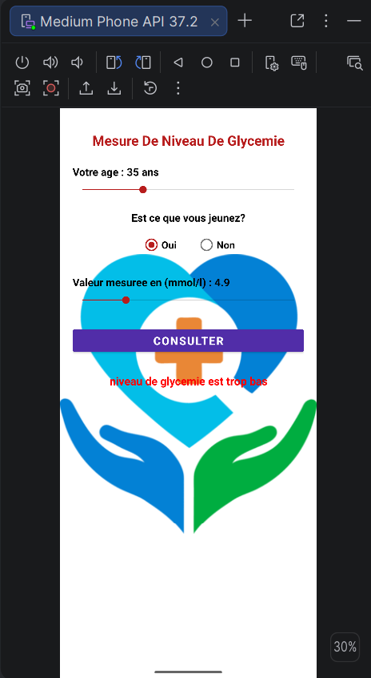
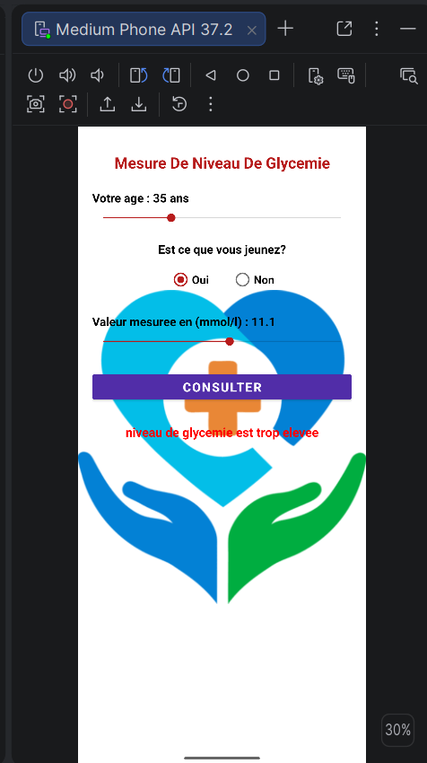

# SalmenZekri_LSI3_DevMobile

**TP2 — Mesure De Niveau De Glycemie**

| Info | Detail |
|---|---|
| Etudiant | Salmen Zekri |
| Filiere | LSI3 |
| Matiere | Developpement Mobile |
| Annee | 2026-2027 |
| Enseignante cours | Sahar Dammak |
| Enseignante TP | Fourati Hela |

---

## Description

Application Android permettant de mesurer le niveau de glycemie d'un patient diabetique. L'utilisateur saisit son age via une SeekBar, indique s'il est a jeun (Oui/Non) via un RadioGroup, puis saisit la valeur mesuree en mmol/l via une seconde SeekBar. En appuyant sur **Consulter**, l'application affiche le niveau de glycemie.

---

## 1. Capture du Layout XML



---

## 2. Code activity_main.xml





```xml
<?xml version="1.0" encoding="utf-8"?>
<FrameLayout xmlns:android="http://schemas.android.com/apk/res/android"
    android:layout_width="match_parent"
    android:layout_height="match_parent">

    <ImageView
        android:id="@+id/imgLogo"
        android:layout_width="match_parent"
        android:layout_height="match_parent"
        android:scaleType="fitCenter"
        android:src="@drawable/back"
        android:contentDescription="Logo" />

    <ScrollView
        android:layout_width="match_parent"
        android:layout_height="match_parent"
        android:fillViewport="true">

        <LinearLayout
            android:layout_width="match_parent"
            android:layout_height="wrap_content"
            android:orientation="vertical"
            android:padding="20dp">

            <TextView
                android:id="@+id/tvTitre"
                android:layout_width="match_parent"
                android:layout_height="wrap_content"
                android:text="Mesure De Niveau De Glycemie"
                android:textSize="22sp"
                android:textStyle="bold"
                android:textColor="#B71C1C"
                android:gravity="center"
                android:layout_marginTop="16dp"
                android:layout_marginBottom="24dp" />

            <TextView
                android:id="@+id/tvAge"
                android:layout_width="match_parent"
                android:layout_height="wrap_content"
                android:text="Votre age"
                android:textSize="17sp"
                android:textStyle="bold"
                android:textColor="#000000"
                android:layout_marginBottom="8dp" />

            <SeekBar
                android:id="@+id/seekBarAge"
                android:layout_width="match_parent"
                android:layout_height="wrap_content"
                android:max="119"
                android:progress="0"
                android:layout_marginBottom="24dp" />

            <TextView
                android:layout_width="match_parent"
                android:layout_height="wrap_content"
                android:text="Est ce que vous jeunez?"
                android:textSize="17sp"
                android:textStyle="bold"
                android:textColor="#000000"
                android:gravity="center"
                android:layout_marginBottom="8dp" />

            <RadioGroup
                android:id="@+id/radioGroupJeune"
                android:layout_width="wrap_content"
                android:layout_height="wrap_content"
                android:orientation="horizontal"
                android:layout_gravity="center"
                android:layout_marginBottom="24dp">

                <RadioButton
                    android:id="@+id/radioOui"
                    android:layout_width="wrap_content"
                    android:layout_height="wrap_content"
                    android:text="Oui"
                    android:textSize="16sp"
                    android:textStyle="bold"
                    android:textColor="#000000"
                    android:checked="true"
                    android:layout_marginEnd="32dp" />

                <RadioButton
                    android:id="@+id/radioNon"
                    android:layout_width="wrap_content"
                    android:layout_height="wrap_content"
                    android:text="Non"
                    android:textSize="16sp"
                    android:textStyle="bold"
                    android:textColor="#000000" />

            </RadioGroup>

            <TextView
                android:id="@+id/tvGlycemie"
                android:layout_width="match_parent"
                android:layout_height="wrap_content"
                android:text="Valeur mesuree en(mmol/l)"
                android:textSize="17sp"
                android:textStyle="bold"
                android:textColor="#000000"
                android:layout_marginBottom="8dp" />

            <SeekBar
                android:id="@+id/seekBarGlycemie"
                android:layout_width="match_parent"
                android:layout_height="wrap_content"
                android:max="190"
                android:progress="0"
                android:layout_marginBottom="32dp" />

            <Button
                android:id="@+id/btnCalculer"
                android:layout_width="match_parent"
                android:layout_height="wrap_content"
                android:text="Consulter"
                android:textSize="18sp"
                android:textStyle="bold"
                android:textColor="#FFFFFF"
                android:backgroundTint="#512DA8"
                android:layout_marginBottom="16dp" />

            <TextView
                android:id="@+id/tvResultat"
                android:layout_width="match_parent"
                android:layout_height="wrap_content"
                android:text=""
                android:textSize="18sp"
                android:textStyle="bold"
                android:gravity="center"
                android:padding="12dp" />

        </LinearLayout>

    </ScrollView>

</FrameLayout>
```

---

## 3. Code Java (MainActivity.java)




```java
package com.example.slmenzekri_lsi3_tp2;

import android.graphics.Color;
import android.os.Bundle;
import android.widget.Button;
import android.widget.RadioButton;
import android.widget.RadioGroup;
import android.widget.SeekBar;
import android.widget.TextView;
import androidx.appcompat.app.AppCompatActivity;

public class MainActivity extends AppCompatActivity {

    SeekBar seekBarAge;
    SeekBar seekBarGlycemie;
    TextView tvAge;
    TextView tvGlycemie;
    RadioGroup radioGroupJeune;
    RadioButton radioOui;
    RadioButton radioNon;
    Button btnCalculer;
    TextView tvResultat;

    @Override
    protected void onCreate(Bundle savedInstanceState) {
        super.onCreate(savedInstanceState);
        setContentView(R.layout.activity_main);

        seekBarAge = findViewById(R.id.seekBarAge);
        seekBarGlycemie = findViewById(R.id.seekBarGlycemie);
        tvAge = findViewById(R.id.tvAge);
        tvGlycemie = findViewById(R.id.tvGlycemie);
        radioGroupJeune = findViewById(R.id.radioGroupJeune);
        radioOui = findViewById(R.id.radioOui);
        radioNon = findViewById(R.id.radioNon);
        btnCalculer = findViewById(R.id.btnCalculer);
        tvResultat = findViewById(R.id.tvResultat);

        tvAge.setText("Votre age : 1 an");
        tvGlycemie.setText("Valeur mesuree en (mmol/l) : 1.0");

        seekBarAge.setOnSeekBarChangeListener(new SeekBar.OnSeekBarChangeListener() {
            @Override
            public void onProgressChanged(SeekBar seekBar, int progress, boolean fromUser) {
                int age = progress + 1;
                if (age <= 1) {
                    tvAge.setText("Votre age : " + age + " an");
                } else {
                    tvAge.setText("Votre age : " + age + " ans");
                }
            }
            @Override
            public void onStartTrackingTouch(SeekBar seekBar) {}
            @Override
            public void onStopTrackingTouch(SeekBar seekBar) {}
        });

        seekBarGlycemie.setOnSeekBarChangeListener(new SeekBar.OnSeekBarChangeListener() {
            @Override
            public void onProgressChanged(SeekBar seekBar, int progress, boolean fromUser) {
                double glycemie = (progress + 10) / 10.0;
                tvGlycemie.setText(String.format("Valeur mesuree en (mmol/l) : %.1f", glycemie));
            }
            @Override
            public void onStartTrackingTouch(SeekBar seekBar) {}
            @Override
            public void onStopTrackingTouch(SeekBar seekBar) {}
        });

        btnCalculer.setOnClickListener(v -> calculerNiveauGlycemie());
    }

    private void calculerNiveauGlycemie() {
        int age = seekBarAge.getProgress() + 1;
        double glycemie = (seekBarGlycemie.getProgress() + 10) / 10.0;
        boolean estJeune = radioOui.isChecked();

        String resultat;
        int couleur;

        if (estJeune) {
            double min;
            double max;
            if (age > 13) {
                min = 5.0;
                max = 7.2;
            } else if (age >= 6) {
                min = 5.0;
                max = 10.0;
            } else {
                min = 5.5;
                max = 10.0;
            }

            if (glycemie < min) {
                resultat = "niveau de glycemie est trop bas";
                couleur = Color.RED;
            } else if (glycemie > max) {
                resultat = "niveau de glycemie est trop elevee";
                couleur = Color.RED;
            } else {
                resultat = "niveau de glycemie est normale";
                couleur = Color.parseColor("#2E7D32");
            }
        } else {
            if (glycemie > 10.5) {
                resultat = "niveau de glycemie est trop elevee";
                couleur = Color.RED;
            } else {
                resultat = "niveau de glycemie est normale";
                couleur = Color.parseColor("#2E7D32");
            }
        }

        tvResultat.setText(resultat);
        tvResultat.setTextColor(couleur);
    }
}
```

---

## 4. Captures de l'application en cours d'execution

| Resultat normal | Trop eleve | Autre |
|:---:|:---:|:---:|
|  |  |  |

---

## Logique metier

### A jeun (Oui)
| Groupe | Intervalle normal |
|---|---|
| Adultes (> 13 ans) | 5.0 – 7.2 mmol/L |
| Enfants 6 – 12 ans | 5.0 – 10.0 mmol/L |
| Enfants < 6 ans | 5.5 – 10.0 mmol/L |

### Apres repas (Non)
- Normal si glycemie <= 10.5 mmol/L
- Trop elevee si glycemie > 10.5 mmol/L
